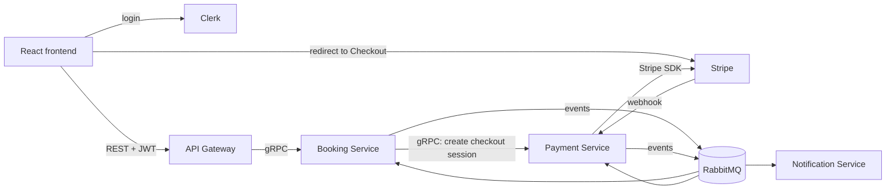
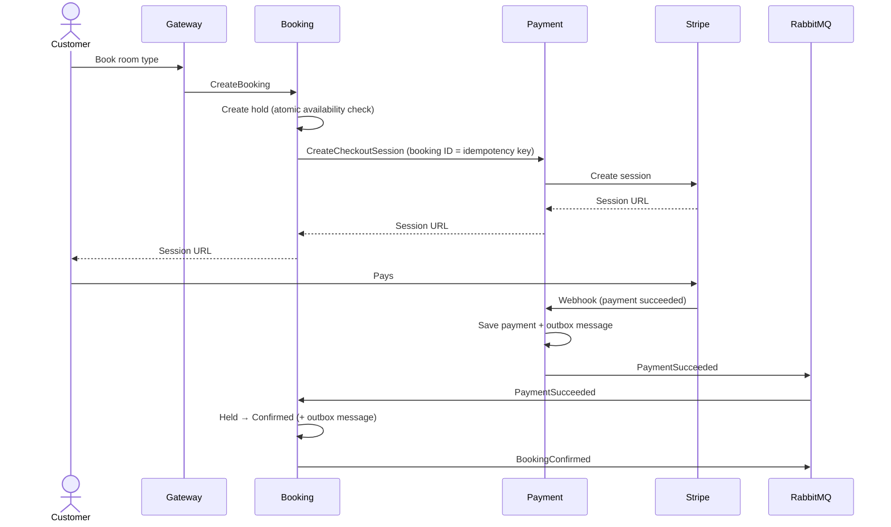

# Architecture

Status: draft (Phase 2)

## Overview

## Services

| Service | Responsibility | Owns data |
|---|---|---|
| API Gateway | JWT validation, rate limiting, routing (REST → gRPC) | Nothing (stateless) |
| Booking Service | Search, availability, holds, booking lifecycle | Hotels, room types, prices, bookings |
| Payment Service | Stripe integration, payments, refunds, webhooks | Payments, refunds, processed Stripe event IDs |
| Notification Service | Emails to customers | Log of sent notifications |

Users are managed by Clerk. Services store only the Clerk user ID. Booking stores the customer's email from the JWT on the booking.

## Communication

| Flow | Path | Type |
|---|---|---|
| Search | Gateway → Booking | Sync |
| Start booking | Gateway → Booking (create hold) → Payment (create Checkout session) | Sync |
| Payment succeeded | Stripe webhook → Payment → `PaymentSucceeded` → Booking | Async |
| Confirmation email | Booking → `BookingConfirmed` → Notification | Async |
| Cancellation | Gateway → Booking (cancel, release room) | Sync |
| Refund | Booking → refund event → Payment | Async |
| Hold expiry | Background job inside Booking | Internal |

Rule of thumb: sync when the user waits for the answer, async when the work can happen later and must survive the receiver being down (NFR-3).

## Booking and payment flow

## Reliability

- **Transactional outbox** in Booking and Payment. Data and outgoing event are saved in the same transaction; a background worker publishes the event. Delivery is at-least-once.
- **Idempotent consumers:**
  - Booking: state-based. `PaymentSucceeded` is ignored if the booking is already `Confirmed`. State changes are single atomic updates.
  - Payment: processed Stripe event IDs.
  - Notification: log of sent notifications.
- **Payment session creation:** booking ID is the idempotency key. Retries return the same session.
- **Payment Service down when starting a booking:** hold is kept, customer sees an error and retries.

## Refunds

Booking decides whether to refund and calculates the amount (it knows the cancellation policy and check-in time). Payment only executes the refund.

- **Cancellation:** 100% or 50% depending on time to check-in.
- **Late payment (FR-12):** `PaymentSucceeded` arrives for an `Expired` booking. Booking checks availability atomically:
  - Room available → `Expired` → `Confirmed`.
  - No room → full refund.

Both cases use the same refund event (e.g. `RefundRequested { BookingId, Amount, Reason }`), published through the outbox. Exact event names and fields are defined in Phase 3.

## Infrastructure

- One PostgreSQL server, one database per service. Each service has its own DB user with access only to its own database.
- Stripe webhooks go directly to Payment Service (`POST /webhooks/stripe`), not through the Gateway. Protected by signature verification (NFR-13).

## Open questions

- None yet.
