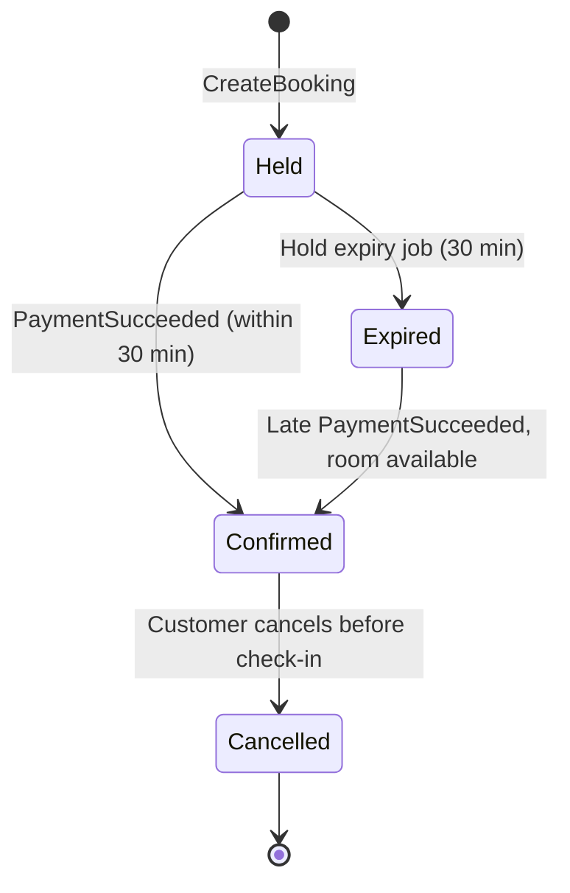

# Data and API Design

Status: draft (Phase 3)

## Booking states



| From | To | Trigger |
|---|---|---|
| — | Held | Customer creates a booking |
| Held | Confirmed | `PaymentSucceeded` within 30 min |
| Held | Expired | Hold expiry job after 30 min |
| Expired | Confirmed | Late `PaymentSucceeded`, room of the same type still available |
| Confirmed | Cancelled | Customer cancels before check-in |

- Late payment with no room available: booking stays `Expired`, Booking publishes a refund event. Refund status lives in Payment Service.
- `Cancelled` is final. All other transitions are not allowed.
- Every transition is a single atomic update with the expected current state in the `WHERE` clause. If two transitions race (e.g. expiry job and `PaymentSucceeded`), only one succeeds.

## Booking Service schema

```
Hotels
  Id, Name, Address, City, ZipCode, Country, CheckInTime, TimeZone

RoomTypes
  Id, HotelId, Name, PricePerNight, TotalRooms

Bookings
  Id, RoomTypeId, ClerkUserId, Email, Status,
  CheckInDate, CheckOutDate, TotalPrice, ExpiresAt, CreatedAt
```

- `TotalRooms` is the fixed number of rooms of this type. Availability is calculated from bookings.
- Money is stored as integer cents (`PricePerNightCents`, `TotalPriceCents`), EUR only. Same unit as Stripe, no rounding issues.
- Availability is counted night by night; the busiest night decides. Back-to-back bookings (10–11 and 11–12) take only one room.
- `TotalPrice` is stored at booking time. Refunds use the amount the customer actually paid.
- Hotel is reached through the room type (no `HotelId` on bookings).
- Column types, indexes and outbox table are defined during implementation.

## Concurrency control

Double booking (NFR-1) is prevented by locking the room type row:

```sql
BEGIN;
SELECT * FROM RoomTypes WHERE Id = @roomTypeId FOR UPDATE;
-- count overlapping bookings:
--   Status = 'Confirmed'
--   OR (Status = 'Held' AND ExpiresAt > now())
-- if count < TotalRooms: INSERT booking
COMMIT;
```

- Concurrent bookings for the same room type wait for each other. Other room types are not affected.
- Trade-off: bookings for the same room type are serialized even for different dates. Fine for our load (NFR-5). A per-night inventory table would scale better but is not needed.
- `ExpiresAt` is the source of truth for hold expiry. The expiry job only updates the status.
- `PaymentSucceeded` confirms directly only if `Status = 'Held' AND ExpiresAt > now()`. Otherwise it goes through the late payment path, which re-checks availability under the same lock.

## Payment states

| Entity | From | To | Trigger |
|---|---|---|---|
| Payment | — | Pending | Checkout session created |
| Payment | Pending | Succeeded | Stripe webhook: payment completed |
| Payment | Pending | Expired | Stripe webhook: session expired |
| Refund | — | Pending | `RefundRequested` event |
| Refund | Pending | Succeeded | Stripe refund succeeded |
| Refund | Pending | Failed | Still failing after several attempts; handled manually |

No `Failed` state for payments: in Stripe Checkout the customer can retry with another card inside the same session, so a session either completes or expires.

## Payment Service schema

```
Payments
  Id, BookingId (unique), StripeSessionId, Amount, Status, CreatedAt

Refunds
  Id, PaymentId (unique), Amount, Reason, Status, Attempts, StripeRefundId, CreatedAt

ProcessedStripeEvents
  EventId (PK), ProcessedAt

OutboxMessages
```

- `BookingId` unique: one payment per booking (NFR-2). Also the idempotency key when creating the Checkout session.
- `PaymentId` unique on refunds: a duplicate `RefundRequested` event cannot create a second refund.
- `Refund.Id` is the Stripe idempotency key, so retries cannot refund twice in Stripe.

## Events

All events go through the outbox (at-least-once). Consumers are idempotent.

| Event | Publisher | Consumers | Payload |
|---|---|---|---|
| `PaymentSucceeded` | Payment | Booking | BookingId, PaymentId, Amount |
| `BookingConfirmed` | Booking | Notification | BookingId, Email, HotelName, RoomTypeName, CheckInDate, CheckOutDate, TotalPrice |
| `RefundRequested` | Booking | Payment, Notification | BookingId, Email, HotelName, RoomTypeName, Amount, Reason (`Cancelled` \| `LatePayment`) |

- Cancellation and late payment without room both use `RefundRequested`. Notification picks the email text from `Reason`.
- Payment ignores the display fields (Email, HotelName, RoomTypeName).

## API contracts

gRPC contracts live in `src/Contracts/Protos`. REST endpoints are in the Gateway.

| REST (Gateway) | Auth | gRPC (Booking) |
|---|---|---|
| `GET /api/search?city=&checkIn=&checkOut=` | No | `SearchAvailability` |

Dates are `yyyy-MM-dd`. Amounts are in cents (EUR).

### Error mapping

Gateway translates gRPC errors to HTTP `application/problem+json`:

| gRPC | HTTP | Detail shown to user |
|---|---|---|
| `InvalidArgument` | 400 | Backend message |
| `NotFound` | 404 | Backend message |
| `FailedPrecondition` | 409 | Backend message |
| `Unavailable` | 503 | Generic message |
| Other | 500 | None |
