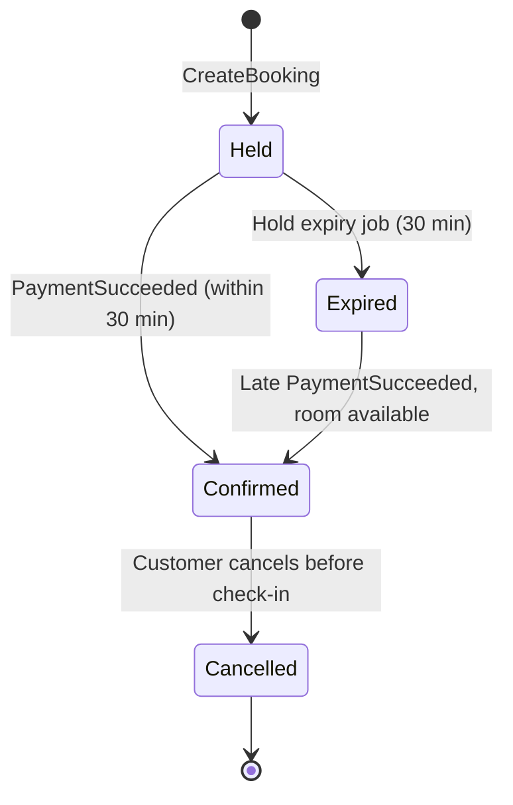

# Data and API Design

Status: draft (Phase 3)

## Booking states



| From | To | Trigger |
|---|---|---|
| — | Held | Customer creates a booking |
| Held | Confirmed | `PaymentSucceeded` within 30 min |
| Held | Expired | Hold expiry job after 30 min |
| Expired | Confirmed | Late `PaymentSucceeded`, room of the same type still available |
| Confirmed | Cancelled | Customer cancels before check-in |

- Late payment with no room available: booking stays `Expired`, Booking publishes a refund event. Refund status lives in Payment Service.
- `Cancelled` is final. All other transitions are not allowed.
- Every transition is a single atomic update with the expected current state in the `WHERE` clause. If two transitions race (e.g. expiry job and `PaymentSucceeded`), only one succeeds.

## Booking Service schema

```
Hotels
  Id, Name, Address, City, ZipCode, Country, CheckInTime, TimeZone

RoomTypes
  Id, HotelId, Name, PricePerNight, TotalRooms

Bookings
  Id, RoomTypeId, ClerkUserId, Email, Status,
  CheckInDate, CheckOutDate, TotalPrice, ExpiresAt, CreatedAt,
  CancelledAt, RefundAmount
```

- `TotalRooms` is the fixed number of rooms of this type. Availability is calculated from bookings.
- Money is stored as integer cents (`PricePerNightCents`, `TotalPriceCents`), EUR only. Same unit as Stripe, no rounding issues.
- Availability is counted night by night; the busiest night decides. Back-to-back bookings (10–11 and 11–12) take only one room.
- `TotalPrice` is stored at booking time. Refunds use the amount the customer actually paid.
- Hotel is reached through the room type (no `HotelId` on bookings).
- Column types, indexes and outbox table are defined during implementation.

## Concurrency control

Double booking (NFR-1) is prevented by locking the room type row:

```sql
BEGIN;
SELECT * FROM RoomTypes WHERE Id = @roomTypeId FOR UPDATE;
-- count overlapping bookings:
--   Status = 'Confirmed'
--   OR (Status = 'Held' AND ExpiresAt > now())
-- if count < TotalRooms: INSERT booking
COMMIT;
```

- Concurrent bookings for the same room type wait for each other. Other room types are not affected.
- Trade-off: bookings for the same room type are serialized even for different dates. Fine for our load (NFR-5). A per-night inventory table would scale better but is not needed.
- `ExpiresAt` is the source of truth for hold expiry. The expiry job only updates the status.
- `PaymentSucceeded` confirms directly only if `Status = 'Held' AND ExpiresAt > now()`. Otherwise it goes through the late payment path, which re-checks availability under the same lock.

## Cancellation

- Only `Confirmed` bookings can be cancelled, until the hotel's local check-in time.
- Refund: 100% if at least 24 h before check-in, otherwise 50% (rounded down to whole cents). Logic in `CancellationPolicy`.
- `CancelledAt` and `RefundAmount` are stored on the booking. Another user's booking returns `NotFound` (NFR-6).
- The `RefundRequested` event is added with the outbox (Phase 5–6).

## Payment states

| Entity | From | To | Trigger |
|---|---|---|---|
| Payment | — | Pending | Checkout session created |
| Payment | Pending | Succeeded | Stripe webhook: payment completed |
| Payment | Pending | Expired | Stripe webhook: session expired |
| Refund | — | Pending | `RefundRequested` event |
| Refund | Pending | Succeeded | Stripe refund succeeded |
| Refund | Pending | Failed | Still failing after several attempts; handled manually |

No `Failed` state for payments: in Stripe Checkout the customer can retry with another card inside the same session, so a session either completes or expires.

## Payment Service schema

```
Payments
  Id, BookingId (unique), StripeSessionId (unique), CheckoutUrl, StripePaymentIntentId, Amount, Status, CreatedAt

Refunds
  Id, PaymentId (unique), Amount, Reason, Status, Attempts, StripeRefundId, CreatedAt

OutboxMessages
  Id (= RabbitMQ message ID), Type (= routing key), Payload (jsonb), CreatedAt, PublishedAt
```

- `BookingId` unique: one payment per booking (NFR-2). `CreateCheckoutSession` returns the saved session's URL if one exists. Concurrent calls may create extra Stripe sessions, but only the saved session's URL is ever returned, so the others expire unpaid. (A Stripe idempotency key does not work here: `expires_at` differs on every call, and Stripe rejects a reused key with different parameters.)
- Checkout sessions expire 30 min after creation (Stripe minimum), so a session can outlive its hold. Payment after hold expiry is a late payment (FR-12).
- Stripe webhooks are idempotent through the state change (`WHERE StripeSessionId = X AND Status = 'Pending'`), not a processed-events table: a duplicate or late event changes no row. Events: `checkout.session.completed` (when `payment_status = paid`) and `checkout.session.async_payment_succeeded` → Succeeded, `checkout.session.expired` → Expired. Others and unknown sessions → 200, ignored. Invalid signature → 400.
- `PaymentId` unique on refunds: a duplicate `RefundRequested` event cannot create a second refund.
- `Refund.Id` is the Stripe idempotency key, so retries cannot refund twice in Stripe.
- `RefundRequested` is consumed from queue `payment.refund-requested`; the handler only saves a Pending refund (ignored if the payment is not Succeeded or the amount is not within the paid amount). `RefundProcessor` (every minute) calls Stripe with the payment intent; after 5 failed attempts → Failed (manual). A refund Stripe accepts is marked Succeeded; `refund.failed` webhooks are not handled yet.

## Events

All events go through the outbox (at-least-once). Consumers are idempotent.

- The state change and the outbox row are saved in one transaction. `OutboxPublisher` (BackgroundService, every second) publishes unpublished rows with publisher confirms and sets `PublishedAt` after RabbitMQ confirms each message.
- RabbitMQ: one durable topic exchange `hotel-booking`; routing key = event type (`payment.succeeded`). Persistent messages, `MessageId` = outbox `Id`. Each consumer declares its own durable quorum queue and a dead letter queue `<queue>.dead` (at-least-once dead lettering). Messages are published as mandatory: if no queue is bound yet, the message stays in the outbox and blocks later ones until a consumer has declared its queue.
- Booking consumes `payment.succeeded` from durable queue `booking.payment-succeeded` (prefetch 1, ack after handling).
- Consumer errors: `EventConsumer` retries while holding the message, up to 20 attempts 5 s apart (about 100 s), then dead letters it. A malformed message is dead lettered at once. A crash redelivers the message and restarts the count. RabbitMQ's `x-delivery-limit` is not used: RabbitMQ 4.4 did not count nacks with requeue towards it (a test reached 1872 deliveries without dead lettering). Dead letters are moved back by hand, which is safe because handlers are idempotent.
- `PaymentSucceeded` handling: Held with a valid hold → Confirmed, with `BookingConfirmed` in the outbox in the same transaction. Held past `ExpiresAt` or Expired → availability checked again under the room type lock (`FOR UPDATE`); room free → Confirmed (also `BookingConfirmed`), otherwise Expired with `RefundAmountCents` set and `RefundRequested` (`LatePayment`, full amount) in the outbox. Confirmed/Cancelled or `RefundAmountCents` already set → ignored (duplicate). Updates use `WHERE Status IN (Held, Expired) AND RefundAmountCents IS NULL`. The current time is read after the lock is acquired.
- Event payload records live in `src/Contracts/Events` (linked into each service like the protos). Outbox publisher and consumer code is shared through `src/Messaging`.

| Event | Publisher | Consumers | Payload |
|---|---|---|---|
| `PaymentSucceeded` | Payment | Booking | BookingId, PaymentId, Amount |
| `BookingConfirmed` | Booking | Notification | BookingId, Email, HotelName, RoomTypeName, CheckInDate, CheckOutDate, TotalPriceCents |
| `RefundRequested` | Booking | Payment, Notification | BookingId, Email, HotelName, RoomTypeName, Amount, Reason (`Cancelled` \| `LatePayment`) |

- Cancellation and late payment without room both use `RefundRequested`. Notification picks the email text from `Reason`.
- Payment ignores the display fields (Email, HotelName, RoomTypeName).

## Notification Service schema

```
Notifications
  Id, BookingId, Type, SentAt
  UNIQUE (BookingId, Type)
```

- Types: `BookingConfirmed`, `BookingCancelled`, `LatePaymentRefund` (FR-17). `RefundRequested.Reason` chooses between the last two.
- Queues: `notification.booking-confirmed`, `notification.refund-requested`.
- The email is sent first and the row saved after it. A crash in between can duplicate an email but not lose one. Failed sending follows the normal consumer retries, so an SMTP outage longer than about 100 s moves messages to the dead letter queue.
- No customer data is stored; the email address and other content come in the event.

## API contracts

gRPC contracts live in `src/Contracts/Protos`. REST endpoints are in the Gateway.

| REST (Gateway) | Auth | gRPC (Booking) |
|---|---|---|
| `GET /api/search?city=&checkIn=&checkOut=` | No | `SearchAvailability` |
| `POST /api/bookings` `{ roomTypeId, checkIn, checkOut }` | Yes | `CreateBooking` |
| `GET /api/bookings` | Yes | `ListBookings` |
| `POST /api/bookings/{id}/cancel` | Yes | `CancelBooking` |
| `POST /api/bookings/{id}/checkout` → `{ checkoutUrl }` | Yes | `StartPayment` → Payment `CreateCheckoutSession` |

- `GET /api/bookings` returns only the signed-in user's bookings, newest first. The user ID comes from the token (NFR-6). A hold past `ExpiresAt` is shown as `Expired` even before the expiry job runs.

- `POST /api/bookings/{id}/checkout` works only for the user's own booking on hold (`Held`, not past `ExpiresAt`), otherwise 409. Calling again returns the same URL. It has a 15 s deadline (Stripe can be slow), which Booking passes on to Payment. Stripe errors → 503.
- Auth: Clerk session token as `Authorization: Bearer`. Gateway validates it against Clerk's keys and passes `sub` and `email` claims to Booking.
- `POST /api/bookings` requires the `email` claim (added to the session token in the Clerk dashboard); without it → 403.
- Rate limit: fixed window per client IP, 100 requests/min by default (`RateLimit:RequestsPerMinute`), 429 when exceeded.

Dates are `yyyy-MM-dd`. Amounts are in cents (EUR).

### Error mapping

Gateway translates gRPC errors to HTTP `application/problem+json`:

| gRPC | HTTP | Detail shown to user |
|---|---|---|
| `InvalidArgument` | 400 | Backend message |
| `NotFound` | 404 | Backend message |
| `FailedPrecondition` | 409 | Backend message |
| `Unavailable` | 503 | Generic message |
| `DeadlineExceeded` (5 s default) | 504 | Generic message |
| Other | 500 | None |
